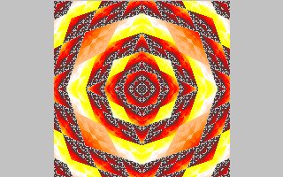
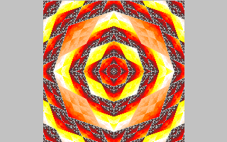
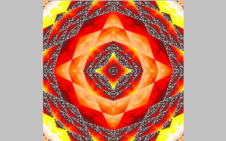
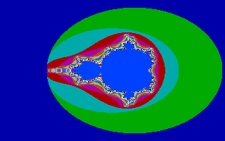
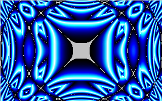
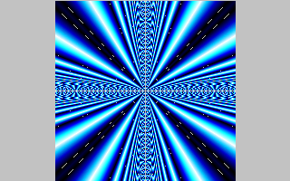
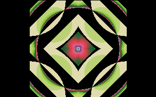
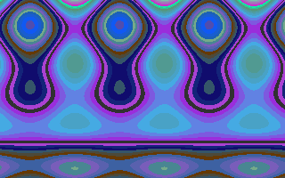
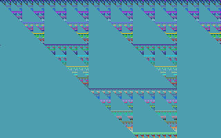
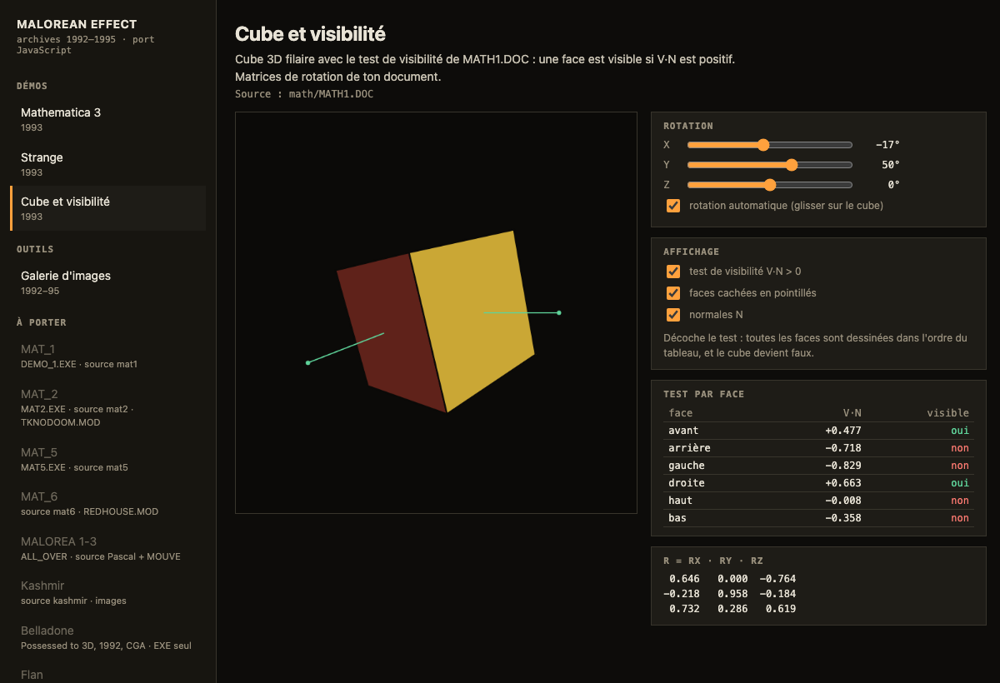

# Les mathématiques derrière les démos Malorean Effect (1993–1994)

Les démos *Mathematica 1, 2, 3, 5 et 6* tiennent en quelques dizaines de kilo-octets et font pourtant défiler des centaines d'images. Aucune n'est un dessin : chaque image est **une formule évaluée sur chaque pixel**, puis colorée par une palette. Cet article explique les principes mathématiques utilisés, avec les extraits de code Pascal d'origine pour les vérifier.

> Les formules sont écrites en LaTeX (`$…$` en ligne, `$$…$$` en bloc). Elles s'affichent dans GitHub, dans l'aperçu Markdown de VS Code, dans Obsidian ou Jupyter (les espaces fines sont écrites `\thinspace`, `\cr` et `\And` plutôt que `\,`, `\\` et `\&` : GitHub supprime l'antislash devant une ponctuation avant de rendre la formule). Les formules importantes sont aussi données en Pascal, lisibles en texte brut.

Toutes les images de cet article sont produites par les démos portées en JavaScript (`PORTAGE_JS/`) ; les extraits de code viennent de `ORIGINAL/DEMO/*/code/`.

## Sommaire

1. [Le cadre : un écran de 64 000 octets et une palette](#1-le-cadre--un-écran-de-64-000-octets-et-une-palette)
2. [La symétrie à huit : calculer un huitième d'écran](#2-la-symétrie-à-huit--calculer-un-huitième-décran)
3. [L'arithmétique entière comme générateur de motifs](#3-larithmétique-entière-comme-générateur-de-motifs)
4. [Les fractales en virgule fixe](#4-les-fractales-en-virgule-fixe)
5. [Produits de polynômes : les quartiques de MAT 5](#5-produits-de-polynômes--les-quartiques-de-mat-5)
6. [Fonctions du plan : racine complexe, rationnelle, sinus](#6-fonctions-du-plan--racine-complexe-rationnelle-sinus)
7. [Les congruences](#7-les-congruences)
8. [Animer sans recalculer : la rotation de palette](#8-animer-sans-recalculer--la-rotation-de-palette)
9. [La 3D : rotations, produit vectoriel et faces cachées](#9-la-3d--rotations-produit-vectoriel-et-faces-cachées)
10. [Pourquoi des entiers partout](#10-pourquoi-des-entiers-partout)
11. [Où retrouver chaque idée](#11-où-retrouver-chaque-idée)

---

## 1. Le cadre : un écran de 64 000 octets et une palette

Les démos tournent en **mode VGA 13h** : 320 × 200 pixels, 256 couleurs. L'écran est un tableau de $320 \times 200 = 64\thinspace 000$ octets à l'adresse `$A000:0000`. Le pixel $(x, y)$ est l'octet d'indice

$$
i = 320\thinspace y + x
$$

Cet octet n'est pas une couleur mais un **numéro de couleur**. La palette (le *DAC* de la carte vidéo) associe à chacun des 256 numéros un triplet rouge-vert-bleu codé sur 6 bits (0 à 63). Une démo se résume donc à trois choses :

1. une fonction $f(x, y, \dots)$ qui donne un entier à chaque pixel ;
2. la réduction de cet entier à un octet, c'est-à-dire **modulo 256** ;
3. une palette (*Volcano*, *Blue*, … reprises de Fractint 17.1, comme le disent les crédits).

$$
\text{couleur}(x, y) = f(x, y) \bmod 256
$$

En Pascal, la réduction est gratuite : affecter une valeur à une variable `Byte` ne garde que ses 8 bits de poids faible.

```pascal
cou := (f+g+g+g) and (1+f+f+g+c);   { cou est un Byte : résultat modulo 256 }
VGA[ofset+f] := cou;
```

Changer de palette change tout l'aspect d'une image sans changer un seul pixel. C'est la base de l'animation par rotation de palette (section 8).

## 2. La symétrie à huit : calculer un huitième d'écran

Presque tous les effets sont dessinés avec **huit axes de symétrie**. Au lieu de calculer $320 \times 200$ points, on calcule un triangle puis on le recopie.

Le centre de l'écran est le pixel $(160, 100)$. Pour un point $(f, g)$ avec $0 \le f \le g \le 99$, on écrit la même couleur en huit endroits :

$$
(\pm f, \pm g) \quad\text{et}\quad (\pm g, \pm f)
$$

C'est l'action du groupe de symétries du carré (le groupe diédral $D_4$, d'ordre 8). Le triangle $0 \le f \le g$ en est un **domaine fondamental** : il contient 5 050 points au lieu de $200 \times 200 = 40\thinspace 000$, soit environ huit fois moins de calculs.

Le code précalcule les décalages mémoire de chaque ligne, pour que chaque écriture ne coûte qu'une addition :

```pascal
For f:=0 to 199 do Mul1[f]:=( f+100)*320+160;   { ligne  +f }
For f:=0 to 199 do Mul2[f]:=(-f+100)*320+160;   { ligne  -f }

for f:=0 to 99 do for g:=f to 99 do begin
  cou := formule(f, g, c);
  V[Mul1[g]+f]:=cou;  V[Mul1[f]+g]:=cou;  V[Mul2[g]+f]:=cou;  V[Mul2[f]+g]:=cou;
  V[Mul2[g]-f]:=cou;  V[Mul2[f]-g]:=cou;  V[Mul1[g]-f]:=cou;  V[Mul1[f]-g]:=cou;
end;
```

La conséquence esthétique est directe : **toute formule, même asymétrique, donne une rosace**. Elle est évaluée dans un seul huitième puis réfléchie.

## 3. L'arithmétique entière comme générateur de motifs

### 3.1 Un anneau $\mathbb{Z}/256$

Les formules de `STRANGE.DOC` mélangent des sommes, des produits et des opérations *bit à bit* (`and`, `or`, `xor`). Par exemple, la formule de `CARLE22.PAS` :

$$
\text{cou}(f, g, c) = \bigl(f + 3g\bigr) \thickspace \And \thickspace  \bigl(1 + 2f + g + c\bigr) \pmod{256}
$$

Ici $c$ n'est pas une troisième dimension d'espace : c'est le **numéro de l'image** de l'animation (de 0 à 1000). Les trois images ci-dessous sont la même formule à $c = 0$, $10$ et $100$.

| $c = 0$ | $c = 10$ | $c = 100$ |
|---|---|---|
|  |  |  |

Une propriété rend ces calculs possibles en n'importe quelle largeur de mots : pour $+$, $-$, $\times$, `and`, `or` et `xor`, les **8 bits de poids faible du résultat ne dépendent que des 8 bits de poids faible des opérandes**. Calculer en 16 bits (type `Word`) ou en 32 bits donne donc la même couleur finale. Ce n'est plus vrai pour `div` et `mod`, qui « voient » les bits de poids fort : dans ces formules, le débordement en 16 bits fait partie du résultat.

### 3.2 `and` et le triangle de Sierpiński

La valeur $x \thinspace \And \thinspace  y$ est nulle exactement quand $x$ et $y$ n'ont **aucun bit à 1 en commun**. L'ensemble des points $(x, y)$ de coordonnées entières où $x \thinspace \And \thinspace  y = 0$ dessine le **triangle de Sierpiński**. La raison vient du triangle de Pascal : le coefficient binomial $\binom{n}{k}$ est impair si et seulement si $k \thinspace \And \thinspace  (n - k) = 0$ (théorème de Lucas). Colorer selon `x and y` revient à colorer le triangle de Pascal selon la parité de ses termes.

Une formule comme $(x+y+y) \thinspace \And \thinspace  (1+x+x+y+z+z+z)$ superpose ainsi une structure de type Sierpiński (les zones granuleuses des images) et des bandes lisses venues des termes linéaires.

### 3.3 Le piège de la priorité en Pascal

En Pascal, `and` a **la même priorité que `*`**, plus haute que `+`. Dans `MAT6.PAS`, `Marc_3` calcule :

```pascal
cou := X*X and y*y;
```

Cela se lit $\bigl((X \cdot X) \thinspace \And \thinspace  y\bigr) \cdot y$, et non $(X^2) \thinspace \And \thinspace  (y^2)$ comme on l'écrirait en C. Toutes les formules de `STRANGE.DOC` ont été portées en tenant compte de cette règle.

## 4. Les fractales en virgule fixe

### 4.1 L'ensemble de Mandelbrot

Pour un point $c = a + ib$, on itère $z_{n+1} = z_n^2 + c$ depuis $z_0 = 0$. En séparant partie réelle et imaginaire ($z = x + iy$) :

$$
x' = x^2 - y^2 + a \qquad y' = 2xy + b
$$

La couleur est le **nombre d'itérations** avant que $|z|^2 = x^2 + y^2$ dépasse 4 (*escape time*), ou le maximum d'itérations si le point ne s'échappe pas.



### 4.2 Sans nombres à virgule : l'échelle $S = 2048$

Le programme n'utilise pas de nombres réels. Chaque coordonnée est multipliée par $S = 2048 = 2^{11}$ et stockée dans un `LongInt` : $X = S\thinspace x$, $Y = S\thinspace y$. Les formules deviennent :

$$
X' = \frac{X^2 - Y^2}{S} + A \qquad Y' = \frac{XY}{S/2} + B
$$

Vérification : $X^2 / S = S\thinspace x^2$ et $XY/(S/2) = 2S\thinspace xy$, ce qui redonne bien $x^2 - y^2$ et $2xy$ à l'échelle $S$. Le programme écrit exactement cela (`DEMO_1.PAS`, `Courbe6`) :

```pascal
Xp:=( (x*x-y*y)  div 2048 )+Px[Xe];
Y :=( (X*y)      div 1024 )+Py[Ye];     { 1024 = 2048/2, donc le facteur 2 de 2xy }
X :=Xp;
module:=SQR(x)+sqr(y);                   { le test : module < 16000000 }
```

Le seuil d'évasion $|z|^2 \lt  4$ devient $X^2 + Y^2 \lt  (2S)^2 = 4S^2 = 16\thinspace 777\thinspace 216$. C'est la constante `16777216` qui revient partout dans `DEMO_1.PAS`.

La fenêtre complexe est un rectangle $[A_{\min}, A_{\max}] \times [B_{\min}, B_{\max}]$, échantillonné par pas constants :

$$
a_i = A_{\min} + \frac{A_{\max} - A_{\min}}{320}\thinspace (i + 1), \qquad b_j = B_{\min} + \frac{B_{\max} - B_{\min}}{200}\thinspace (j + 1)
$$

Ces valeurs sont arrondies une fois pour toutes dans deux tableaux (`Px`, `Py`) : la boucle intérieure n'a plus ni multiplication par les pas ni conversion.

### 4.3 Deux économies

* **Symétrie de conjugaison.** Le point $\bar c = a - ib$ a une orbite conjuguée de celle de $c$ : l'image est symétrique par rapport à l'axe réel. Les boucles font `For Ye:=0 to 100` et écrivent deux lignes, `ye` et `199-ye`.
* **Décalages.** Diviser par $2048 = 2^{11}$ peut s'écrire `shr 11`, plus rapide qu'une division. Plusieurs courbes l'utilisent (`Courbe5`, `L15`).

### 4.4 Quand le débordement 32 bits fait partie de l'image

Les `LongInt` de Turbo Pascal sont sur 32 bits **sans détection de débordement**. Avec le module habituel $X^2 + Y^2$, le débordement n'arrive jamais : la boucle s'arrête dès que $X^2 + Y^2 \ge 4S^2$, c'est-à-dire pour $|X|, |Y| \lt  4096$, et l'itération suivante donne au plus $|X'| \approx 8192$, soit $X'^2 \approx 6{,}7 \cdot 10^7 \ll 2^{31}$.

Plusieurs courbes (`Courbe2`, `EsFrac2`, `EsFrac5`, `Mandel10`) changent pourtant le module en $X^2 - 16\thinspace Y^2$. Ce module peut être **négatif**, donc le test `module < 16777216` reste vrai même quand l'orbite s'échappe. $X$ croît alors comme $X^2/S$ à chaque pas, dépasse $2^{31}$ en une poignée d'itérations, et la valeur « boucle » en $\mathbb{Z}/2^{32}$. Ces images ne sont plus des fractales de Mandelbrot mais des **motifs de chaos arithmétique**, que le port JavaScript reproduit en imposant le même repliement 32 bits (`Math.imul`, `|0`). `Courbe2`, `EsFrac2` et `EsFrac5` colorent aussi les points restants par `x mod y`.

## 5. Produits de polynômes : les quartiques de MAT 5

`MAT5.PAS` (*« idées sur la manipulation des quartiques »*) définit une fonction du second degré en $x$ et $y$ :

$$
I_Q(x, y) = d_{2x}\thinspace x^2 + d_{2y}\thinspace y^2 + d_{1x}\thinspace x + d_{1y}\thinspace y + d_0
$$

Les images sont les produits de deux ou trois telles fonctions, divisés par une grande constante :

$$
\text{couleur}(x, y) = \Bigl\lfloor \frac{I_{Q_1}(x, y)\thickspace  I_{Q_2}(x, y)}{10\thinspace 000} \Bigr\rfloor \bmod 256
$$

Une courbe $I_{Q_1} I_{Q_2} = \text{constante}$ est un produit de deux coniques : c'est une **courbe de degré 4**, une quartique. La palette étale la famille de ces courbes de niveau en bandes. La division par $10^4$, $3 \cdot 10^6$ ou $10^7$ règle la **densité des bandes** : plus la constante est grande, moins elles sont serrées.



Détail d'arithmétique : la fonction `Image` calcule en `Integer` (16 bits signés), donc ses valeurs **bouclent à $\pm 32768$** avant d'être multipliées en 32 bits. Ces débordements peuvent découper l'image en zones aux contours nets.

## 6. Fonctions du plan : racine complexe, rationnelle, sinus

### 6.1 La racine carrée complexe

`MAT3.PAS` contient `RAC_3` et `RAC_4`, qui ressemblent à des formules arbitraires. Elles sont en fait des fonctions de la **racine carrée complexe**. Pour $z = x + iy$ et $\sqrt{z} = a + ib$ :

$$
a^2 = \frac{|z| + x}{2}, \qquad b^2 = \frac{|z| - x}{2}, \qquad |z| = \sqrt{x^2 + y^2}
$$

* `RAC_3` : $20\sqrt{|z| - x} + 20\sqrt{|z| + x} = 20\sqrt{2}\thinspace (|a| + |b|)$. L'image est constituée des courbes de niveau de $|{\Re\sqrt z}| + |{\Im\sqrt z}|$.
* `RAC_4` : $100\thinspace \dfrac{|z| + x}{y}$. Comme $y = 2ab$ et $|z| + x = 2a^2$, ce rapport vaut $100\thinspace \dfrac{a}{b}$, soit $100 \cot\dfrac{\theta}{2}$ où $\theta$ est l'angle polaire de $z$. **La couleur ne dépend que de l'angle** : l'image est faite de rayons qui partent de l'origine.

```pascal
COU:=ROUND( 100*(SQRT(Xe*Xe+Ye*Ye)+Xe)/Ye );     { RAC_4 : 100 cot(theta/2) }
```



### 6.2 Une fonction rationnelle : des cercles qui grandissent

La procédure `Pasm` (répertoire *flower*) colore avec

$$
\text{cou}(a, b, t) = \frac{2\thinspace (a + b)\thinspace t}{a^2 + b^2}
$$

où $a$ et $b$ sont les coordonnées du point (échelle de 1 à 301) et $t$ le numéro d'image, de 1 à 300. La courbe de niveau $\text{cou} = k$ s'écrit

$$
\Bigl(a - \frac{t}{k}\Bigr)^2 + \Bigl(b - \frac{t}{k}\Bigr)^2 = 2\thinspace \frac{t^2}{k^2}
$$

C'est un **cercle qui passe par l'origine**, de rayon $\sqrt2\thinspace t/k$. Quand $t$ augmente, tous les cercles grandissent en restant tangents à l'origine, d'où l'impression d'expansion. La symétrie à huit complète le dessin. Dans le code, $a^2 + b^2$ est stocké en `Word` : au-delà de 65 535 (soit $a, b \gtrsim 181$), il se replie et déforme la fonction rationnelle sur les bords de la figure.



### 6.3 Les sinus : des tables à une variable

Les effets `ES2`, `ES3`, … utilisent des fonctions trigonométriques, par exemple `ES2` :

$$
\text{cou}(x, y) = \operatorname{round}\bigl((x + y)\thinspace \sin x\bigr), \qquad x, y \in [-10, 10]
$$

Le calcul de $\sin x$ sur $64\thinspace 000$ pixels serait lent sur les processeurs de l'époque, et les `Real` du Pascal (6 octets) sont émulés quand il n'y a pas de coprocesseur. L'astuce tient dans la **séparabilité** : $\sin x$ ne dépend que de la colonne. Le programme précalcule deux tableaux, `SinX[320]` et `CosY[200]`, soit 520 appels à `Sin` et `Cos` au lieu de $64\thinspace 000$ :

```pascal
For xe:=0 to 319 do SinX[xe]:=Sin(Px[xe]);
...
Cou:=Round((PartieB+Py[Ye])*PartieA);      { PartieA = SinX[Xe], PartieB = Px[Xe] }
```



### 6.4 Les nombres triangulaires

Dans `Moy_3` et `Moy_4`, le tableau `SOMME` contient les nombres triangulaires :

$$
S_n = \sum_{k=1}^{n} k = \frac{n(n+1)}{2}, \qquad \text{cou} = S_{x+y} + S_{x+t}
$$

Là encore, la table remplace un calcul : la somme est calculée une fois, puis lue.

## 7. Les congruences

Les procédures `CONG1`, `CONG2`, … (*« Cong part, code by Volpone, 1993 »*) colorent chaque point par un résultat d'arithmétique modulaire :

```pascal
ca:=1;
repeat  inc(ca);  until (g mod ca = f) or (ca = 250);
cou:=ca;
```

La condition $g \bmod ca = f$ signifie que $ca$ **divise $g - f$ et est strictement supérieur à $f$**. La couleur est donc

$$
\text{couleur}(f, g) = \min\bigl\lbrace \thinspace  d \ge 2 \thickspace :\thickspace  d \mid (g - f),\thickspace  d \gt  f \thinspace \bigr\rbrace  \quad (\text{limité à } 250)
$$

C'est le plus petit diviseur de $g - f$ qui dépasse $f$. Dans le cas limite $f = 0$ (que `CONG1` ne trace pas, il commence à $f = 1$), c'est tout simplement le **plus petit facteur premier** de $g$. Ces images sont donc des cartes de diviseurs : le plus petit diviseur admissible change brusquement quand on traverse un multiple, ce qui explique les blocs triangulaires de la figure.



D'autres procédures `CONG` remplacent la condition par des variantes : `(f xor g) = ca`, `(f and g) = ca`, `(f - g) = (ca xor g)`, etc.

## 8. Animer sans recalculer : la rotation de palette

Recalculer 64 000 pixels à chaque image est lent. Les démos de `MAT_2` et `MAT_6` animent de deux façons.

1. **Recalcul, avec un paramètre de temps** : l'image $c$ est calculée puis affichée (c'est le cas de `Strange`, section 3).
2. **Rotation de palette** : les pixels ne bougent pas. On **décale les entrées de la palette** (couleur $i$ prend le triplet de la couleur $i - 1$), donc les bandes semblent défiler.

$$
\text{pal}'[1] = \text{pal}[255], \qquad \text{pal}'[i] = \text{pal}[i-1] \quad (2 \le i \le 255)
$$

L'entrée 0 (le fond) reste fixe. Le coût d'une image est la réécriture de $256 \times 3 = 768$ octets dans le DAC (ports `3C8h`/`3C9h`), contre $64\thinspace 000$ pour l'écran : 83 fois moins.

```pascal
PalInter:=Pal1;
For F:=1 To 255 Do Pal1[f]:=PalInter[f-1];
Pal1[1]:=PalInter[255];
{ puis écriture des 256 triplets dans le DAC, et attente de NbPulse ticks }
```

La cadence est donnée par le compteur du BIOS à l'adresse `$0040:$006C`, incrémenté par l'horloge de la carte mère à

$$
\frac{1\thinspace 193\thinspace 182}{65\thinspace 536} \approx 18{,}2 \text{ Hz}
$$

Dans `MAT6.PAS`, la fin de l'animation **accélère** : on passe de une rotation par tick à deux, puis à trois, puis à cinq, ce qui fait défiler les couleurs de plus en plus vite sans toucher aux pixels.

## 9. La 3D : rotations, produit vectoriel et faces cachées

`MATH1.DOC` rassemble les outils de la 3D filaire.

### 9.1 Produits scalaire et vectoriel

$$
U \cdot V = U_x V_x + U_y V_y + U_z V_z
$$

$$
U \wedge V = \begin{pmatrix} U_y V_z - V_y U_z \cr  U_z V_x - V_z U_x \cr  U_x V_y - V_x U_y \end{pmatrix}
$$

### 9.2 Rotations élémentaires

Les matrices sont écrites pour des **vecteurs ligne** ($P' = P\thinspace R$), convention des années 90 :

$$
R_x = \begin{pmatrix} 1 & 0 & 0 \cr  0 & \cos x & \sin x \cr  0 & -\sin x & \cos x \end{pmatrix} \quad R_y = \begin{pmatrix} \cos y & 0 & -\sin y \cr  0 & 1 & 0 \cr  \sin y & 0 & \cos y \end{pmatrix} \quad R_z = \begin{pmatrix} \cos z & \sin z & 0 \cr  -\sin z & \cos z & 0 \cr  0 & 0 & 1 \end{pmatrix}
$$

Ce sont les transposées des matrices « colonne » des manuels actuels. Dans la démo web, une rotation quelconque est le produit $R = R_x R_y R_z$ : chaque sommet $P$ du cube est transformé en $P' = P R$.

### 9.3 Projection

`MATH1.DOC` ne donne pas la projection ; la démo web utilise la perspective classique. Un point $(x, y, z)$ placé devant l'observateur se projette sur l'écran en

$$
x_{\text{écran}} = 160 + F\thinspace \frac{x}{z}, \qquad y_{\text{écran}} = 100 - F\thinspace \frac{y}{z}
$$

où $F$ est la distance focale (le facteur de perspective). Plus $z$ est grand, plus l'objet est petit.

### 9.4 Faces cachées

Pour un solide convexe, une face n'est visible que si elle **tourne le dos à l'objet et fait face à l'observateur**. `MATH1.DOC` donne la méthode en quatre lignes :

1. calculer la normale $N$ de la face (par un produit vectoriel de deux de ses côtés, orientée vers l'extérieur du solide) ;
2. calculer le vecteur vision $V$ de la face vers l'observateur ;
3. calculer $V \cdot N$ ;
4. si $V \cdot N \gt  0$, la face est visible.

$$
N = (B - A) \wedge (C - A), \qquad \text{visible} \iff V \cdot N \gt  0
$$

Le signe du produit scalaire est le signe du cosinus de l'angle entre les deux vecteurs : positif si l'angle est aigu, c'est-à-dire si la face « regarde » vers l'observateur. Le test élimine d'un coup à peu près la moitié des faces, sans tri ni calcul d'intersections.



La démo web *Cube et visibilité* affiche la valeur de $V \cdot N$ de chaque face ; en décochant le test, on voit apparaître les faces de l'arrière et le cube devient faux.

## 10. Pourquoi des entiers partout

Presque toutes les formules sont en entiers, avec des tables précalculées. Plusieurs indices dans les sources l'expliquent :

* Les en-têtes des programmes (`MALOREA1.PAS`) demandent `{$G+}` (instructions 80286) et `{$N-}` (**pas de coprocesseur 8087**). Sans coprocesseur, un `Real` est émulé par logiciel : très lent.
* Les tables sont partout : `Mul320[y] = 320 y` (évite une multiplication par pixel), `CARRE[n] = n²`, `SinX`, `CosY`, `SOMME`.
* Les divisions par des puissances de 2 deviennent des décalages (`shr 11`), et les facteurs 2 sont absorbés dans les constantes (`div 1024` pour $2xy$).
* La symétrie à huit divise le travail par huit.
* La rotation de palette (section 8) évite de toucher à l'écran.

Le même raisonnement explique la forme des procédures : une boucle sur $f$, une sur $g \ge f$, **une seule formule, huit écritures**. C'est ce qui rend l'animation possible avec la puissance de l'époque.

## 11. Où retrouver chaque idée

| Idée | Source d'origine | Démo web (`PORTAGE_JS`) |
|---|---|---|
| Symétrie à huit, formules entières | `CODE hors demo/STRANGE/CARLE*.PAS`, `docs/STRANGE_formules.pdf` | *Strange* |
| Fractales en virgule fixe | `DEMO/MAT_1/code/SOURCE/DEMO_1.PAS` | *Mathematica 1* |
| Effets Carle, Rotate, ExPoly, Cong, Es | `DEMO/MAT_2/code/SOURCE/DEM2.PAS` | *Mathematica 2* |
| Racine complexe, rationnelle, nombres triangulaires, polynômes | `DEMO/MAT_3/code/MAT3.PAS` | *Mathematica 3* |
| Quartiques | `DEMO/MAT_5/code/MAT5.PAS` | *Mathematica 5* |
| Formules `Marc`, rotation de palette | `DEMO/MAT_6/code/MAT6.PAS` | *Mathematica 6* |
| Produits scalaire et vectoriel, rotations, faces cachées | `math/MATH1.DOC` | *Cube et visibilité* |

Pour les relire, ouvrir `PORTAGE_JS/index.html` dans un navigateur : la colonne de gauche liste les démos, la vitesse se règle, et la description de chaque scène nomme la procédure Pascal d'origine.
