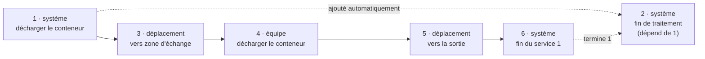

# SIGMA : simuler un terminal à conteneurs avec des services

> Système générique de simulation discrète basé sur la notion de service.
> Mémoire d'ingénieur CNAM (Rouen), laboratoire PSI de l'INSA de Rouen, projet européen Intraseas, noyau écrit en Java.

Ce document explique le projet dans l'ordre : le **problème** posé, la **solution fonctionnelle**, puis l'**implémentation**, qui ressemble à un système multi-agents. Les sources et le binaire restent dans `SIGMA_ORIGINAL/`, qui n'est pas publié. Seules les idées sont décrites ici.

Une page interactive accompagne ce texte : elle rejoue l'ordonnanceur de SIGMA pas à pas (`sigma-explorer.html`).

## Qui a fait quoi

- **Le noyau SIGMA** (modèle, composants, échéancier) est décrit dans le mémoire d'ingénieur CNAM de Christophe Mames. C'est la source de ce document.
- **Le travail de L. Deséchalliers** (diaporamas et planche A3 de `SIGMA_ORIGINAL/documentation/desechalliers/`, soutenance CESI Rouen du 14 octobre 2003, Mastère Spécialisé en Management de projet informatique en milieu industriel) porte sur la **version 1.1** : rétro-ingénierie, découplage du système, inversion des responsabilités à l'initialisation du scénario, pattern Consumer/Manager/Strategy, refactoring du service de déplacement (`GoTo`), recherche de dépendances des événements, éditeur de service et visionneuse. Un article à part le raconte : `article-malorean.md`.

---

## 1. Le problème

### Un port ne se teste pas en vrai

Un terminal à conteneurs est un site où arrivent des navires et des camions. Des engins de manutention (grues, chariots cavaliers) déplacent les conteneurs entre le quai, les zones de stockage et la sortie. Les questions que se pose un exploitant sont coûteuses :

- Combien de grues et de chariots faut-il pour tenir un volume de trafic ?
- Où placer les zones de stockage ?
- Quelle règle d'organisation des équipes donne le meilleur débit ?

Changer la géographie du site ou acheter un engin coûte trop cher pour être essayé « pour voir ». La **simulation** répond à ce besoin : on construit un modèle informatique du terminal et on compare des stratégies avant de les appliquer.

### Quel type de simulation ?

Le terminal est un système à **événements discrets** : l'état change à des instants précis (un camion arrive, une grue finit de décharger), pas de façon continue. Le mémoire passe en revue les approches (par événements, par activité, ABC, par processus) et les outils existants (GPSS, Simscript, Modsim, Taylor, Pasion), puis la simulation distribuée avec le standard militaire américain **HLA**. Le laboratoire a retenu l'approche **par processus**.

### Le point de départ : SGTC, un prototype à jeter

Le laboratoire PSI disposait de **SGTC** (Système de Gestion d'un Terminal à Conteneurs) :

- écrit en CLOS (la couche objet de Lisp), environ 6 hommes-années ;
- validé avec le port du Havre, puis avec le projet européen **Intraseas** (7 pays) sur un terminal fictif : 8 zones de stockage, 2 postes d'accostage, 2 zones d'échange de 15 places ;
- testé sur quatre scénarios de base : navire import, navire export, camion import/export, et une « noria ».

SGTC avait deux bonnes idées : une gestion intégrée des **ressources** (avec des politiques d'allocation) et des **macro-processus** (un processus qui se décompose, ce qui permet de « zoomer »). Mais il avait des défauts :

| Défaut de SGTC | Conséquence |
|---|---|
| Héritage multiple massif en Lisp | Code difficile à comprendre, méthodes jamais appelées, classes « tampon » inutiles |
| Description d'un site pénible | Fichiers de données en listes Lisp, peu lisibles |
| Comportement des ressources enfoui dans le code | Modifier une ressource oblige à plonger dans les sources |
| Conçu comme prototype | Plus jetable qu'extensible |

Question du mémoire : faire évoluer SGTC ou repartir de zéro ? Réponse : **un nouveau noyau, SIGMA**.

---

## 2. La solution fonctionnelle

### Les ambitions

1. **Réutilisabilité** des composants, y compris hors du port, pour tout site où la manutention est centrale.
2. **Extensibilité** : ajouter un serveur, un client, une ressource ou un service se fait en créant une classe.
3. **Portabilité** : Java « 100 % pur » (vérifié avec l'outil JavaPureCheck après chaque modification).
4. **Interopérabilité** : une architecture inspirée de HLA, pour une distribution future.

### Le vocabulaire du modèle

| Notion | Rôle | Exemples |
|---|---|---|
| **Client** | Entre dans le système avec une demande | un camion, un navire |
| **Serveur** | Exécute des services avec ses propres ressources | équipe camion, équipe navire, déplacement, zone de stockage |
| **Service** | Ce qu'un client demande à un serveur | « décharger un conteneur », « aller à la sortie » |
| **Ressource** | Objet géré et alloué | chariot cavalier, grue, voie |
| **Événement** | Un service demandé, daté, avec des conditions | voir plus bas |
| **Scénario** | Le jeu de données d'une simulation | fichier XML |

Un événement est le triplet **(serveur, ressource/client, service)**, complété par une heure, un numéro et la liste des événements qui doivent être terminés avant lui.

### Ce que fait un utilisateur

1. Il décrit un **scénario** en XML : les serveurs et leurs ressources, puis les clients et leurs heures d'arrivée.
2. Il lance la simulation.
3. Il lit la **trace** d'exécution et les **indicateurs** statistiques, puis compare avec d'autres scénarios.

Extrait de scénario (réduit) :

```xml
<scenario>
  <serveurs>
    <EquipeCamion name="équipe camion import">
      <CCProvider name="cc prov 1">
        <ChariotCavalier name="CC1" capacite="1" />
      </CCProvider>
    </EquipeCamion>
  </serveurs>
  <clients>
    <Camion name="camion 1" import="2" export="2" heure="10" />
    <Navire name="navire 1"  import="30" export="0" heure="10" />
  </clients>
</scenario>
```

Les balises portent le type des objets, leurs attributs portent les paramètres, et l'imbrication exprime l'appartenance (un chariot appartient à un fournisseur, qui appartient à une équipe). Le XML a été choisi pour sa syntaxe standard et sa portabilité, pas pour le web.

### Le déroulé d'un camion

Un camion arrive pour se faire décharger. Il demande un service au système, qui le décompose :



Chaque flèche est une **dépendance** : un événement n'est activable que si les événements dont il dépend sont terminés. Deux branches sans dépendance commune peuvent donc s'exécuter en parallèle.

---

## 3. L'implémentation

### Architecture en couches et en composants

Le mémoire propose quatre couches, puis constate que plusieurs composants chevauchent plusieurs couches. Il part donc des **composants** et leur affecte des couches ensuite.

| Couche | Contenu |
|---|---|
| Base | Algorithmes : tris, graphes, listes, files |
| Noyau | Gestionnaires de ressources, d'événements, de processus, de pannes, de stratégies |
| Métier (portuaire) | Gestionnaire de services et acteurs |
| Interface | Site, scénario, expérience, graphique |

Quatre composants métier :

| Composant | Tâches qu'il sait faire |
|---|---|
| **Déplacement** | Déplacer un objet O vers un point P, en utilisant les voies |
| **Équipe** | Décharger un conteneur de O, charger un conteneur sur O |
| **Zone de stockage** | Ranger le conteneur d'un engin, donner un conteneur à un engin |
| **Système** | Transformer les données brutes (fichier, base, commandes) en tâches ; fin de tâche ; fin de traitement |

La règle de conception : chaque composant **gère ses propres ressources**, et deux composants ne partagent pas de ressource. C'est le gain principal sur SGTC, où la gestion était globale. Les composants s'échangent de simples messages : *une ressource + une directive sur cette ressource*, sans passer par une unité centrale.

### Le cœur : un échéancier d'événements

La simulation est une boucle sur un **échéancier** (la file des événements en attente, triée par date) :

```
tant qu'il reste des événements :
    pour chaque événement, dans l'ordre de l'échéancier :
        si toutes ses conditions sont vérifiées → c'est le prochain activable
    horloge = max(horloge, heure de l'événement)
    retirer l'événement de l'échéancier
    demander à son serveur d'exécuter le service sur la ressource
        (l'exécution peut poster de nouveaux événements)
```

Points d'implémentation à retenir :

- `post()` ajoute un événement et **renvoie son numéro**. L'appelant s'en sert comme condition d'un autre événement.
- Un service peut se décomposer en sous-services. Il doit toujours poster un événement « **fin du service** » pour signaler qu'il est terminé. Le service spécial **runTask** exécute une tâche simple sur une ressource.
- Les événements terminés sont **recyclés** plutôt que recréés, car en créer des millions coûte cher.

### Les ressources sans blocage

Dans SGTC, un processus qui demandait une ressource indisponible restait bloqué dans un objet « waitingObject ». Dans SIGMA, **allouer et libérer sont eux-mêmes des services** :

- On poste une demande et on continue. Si on a besoin de la ressource plus tard, on met la demande en **condition** d'un événement.
- Si aucune ressource n'est libre, l'allocateur garde la demande dans sa liste et **rend la main** à la simulation sans poster la fin de la demande.
- À chaque nouvelle demande ou libération, l'allocateur relit sa liste. S'il peut en satisfaire une, il alloue la ressource et poste l'événement de fin.

### Du Lisp à Java : sortir de l'héritage multiple

Java n'a que l'héritage simple, donc le modèle de SGTC a été simplifié :

- Les sous-classes de conteneur (1 ou 2 EVP, import, export, transbordement) ne servaient qu'à porter un attribut : une seule classe `Container` suffit, avec le type et le statut passés au constructeur.
- Les héritages redondants (C hérite de B qui hérite de A, et C hérite aussi de A) sont supprimés.
- Pour le reste, on arbitre au cas par cas entre dupliquer un peu de code et réorganiser l'arbre, en s'aidant des **interfaces**.

### Méthode et extension

Le développement a suivi l'**extreme programming**, avec UML pour décrire le modèle et des **design patterns** pour tenir la réutilisabilité. Pour étendre le noyau : hériter de la classe abstraite voulue (serveur, client, ressource, service), implémenter les méthodes obligatoires, garder les nouvelles méthodes `private`, et poster l'événement de fin dans tout service.

---

## 4. SIGMA vu comme un système multi-agents

**Précision d'honnêteté** : le mémoire ne parle pas de « système multi-agents ». Le mot « agent » n'apparaît que dans la bibliographie. Le rapprochement ci-dessous est une lecture, pas une affirmation de l'auteur.

Ce qui rapproche SIGMA d'un SMA :

| Idée d'un SMA | Dans SIGMA |
|---|---|
| Entités autonomes avec leur propre état | Chaque **serveur** possède ses ressources et ses gestionnaires. Rien n'est partagé entre serveurs |
| Communication par messages | Les composants s'échangent *(ressource, directive)*, sans chef d'orchestre central |
| Décomposition d'un but en sous-buts | Un service se décompose en sous-services (macro-processus) |
| Coordination par dépendances | Les conditions entre événements synchronisent les serveurs et permettent le parallélisme |
| Perception de l'environnement | Le serveur voit la ressource qui le sollicite et l'état de ses allocateurs |

Ce qui l'en sépare, et c'est important :

| Un SMA « complet » | SIGMA aujourd'hui |
|---|---|
| Les agents décident seuls | Le serveur **exécute** ce que l'événement lui impose. Les décisions viennent du scénario et des stratégies |
| Exécution concurrente | Un seul échéancier et une horloge globale : l'exécution est séquentielle |
| Équipes qui se forment dynamiquement | Les serveurs sont **fixes**, déclarés dans le XML |

### Les évolutions que le mémoire propose

Les pistes de la section « Évolutions » vont précisément vers le multi-agents :

1. **Bourse de services** : les clients publient leurs demandes dans une bourse. Une équipe se constitue dynamiquement en la consultant, et les équipes peuvent se défaire et se reformer en cours de simulation. L'auteur la présente comme « la prochaine évolution de SIGMA ». Le **gestionnaire de stratégies** composerait lui-même l'équipe (ressources et méthodes de travail) pour chercher une meilleure productivité. C'est le schéma d'un marché de tâches entre agents.
2. **Architecture HLA** : renommer les méthodes comme dans HLA et passer en *call-back*. Chaque serveur pourrait alors devenir un **simulateur à part entière** (un simulateur de déplacement, par exemple), et on pourrait simuler plusieurs sites ensemble.
3. **Trace sélective**, **éditeur de services** (stocker le graphe de décomposition dans un fichier), **éditeur de site** (voies de circulation avec limite de vitesse, types de véhicules, capacité), **zones de stockage** détaillées (travées, étages), **interface graphique** à base de sprites, et un **assistant à la simulation** développé en thèse au laboratoire.

---

## 5. Carte du dépôt

| Élément | Contenu | Publié |
|---|---|---|
| `SIGMA_ORIGINAL/binaire/` | `sigma.jar` exécutable | non |
| `SIGMA_ORIGINAL/scenarios/` | Scénarios XML (1 équipe, 5 équipes, 100 conteneurs, montée en charge mémoire, Intraseas) | non |
| `SIGMA_ORIGINAL/javadoc/` | Documentation du code (19 packages : `server`, `service`, `resource`, `consumer`, `way`, `task`, `simulation`, `scenario`…) | non |
| `SIGMA_ORIGINAL/Etude UML/` | Diagrammes de conception | non |
| `SIGMA_ORIGINAL/documentation/` | Mémoire de C. Mames, diaporamas, mémoire de stage | non |
| `SIGMA/SIGMA.md` | Ce document | oui |
| `SIGMA/sigma-explorer.html` | La page interactive | oui |
